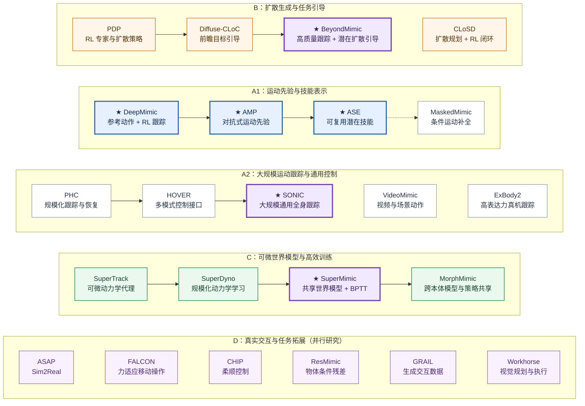

# 通用人形全身控制

> 更新：2026-10-31
> 收录：**23 篇**论文／技术工作，其中以 ★ 标识 **6 篇核心论文**
> 说明：本图是一张 **问题与方法的发展路线图**，主要是范式演进和研究关联，而非严格的引用依赖图。

## 0. 目录与阅读方法

- [1. 横向路线图](#1-横向路线图)
- [2. 每行的研究主线](#2-每行的研究主线)
- [3. 三篇跨路线关键工作](#3-三篇跨路线关键工作)
- [4. 六篇核心论文速览](#4-六篇核心论文速览)
- [5. 完整论文索引：全部 23 篇](#5-完整论文索引全部-23-篇)
- [6. 演进脉络总结](#6-演进脉络总结)
- [7. 仓库维护与图片显示](#7-仓库维护与图片显示)

### 关系说明

- **实线箭头**：直接延续或较明确的方法进展，仍不等同于复用代码。
- **虚线箭头**：问题关联、方法互补、作者脉络或同期平行探索，不是技术继承。
- **点线箭头**：主要用于实验结果、训练效率等方面的横向比较。

---

## 1. 横向路线图（Mermaid，GitHub 原生渲染）

下图使用 **五条横向排列的研究行（B / A1 / A2 / C / D）**，其中 A1、A2 同属运动模仿主干 A。每行只保留该路线内部的演进关系，**不再绘制穿过其他研究行的长连线**。



> **图的阅读方式**：带 ★ 的六篇为核心论文；其中 BeyondMimic 位于 B 行终点，代表动作跟踪与目标引导生成的交叉；SONIC 位于 A2 行终点，代表规模化通用跟踪；SuperMimic 位于 C 行核心，代表共享可微模型与高效训练。由于跨行交叉连线会明显降低可读性，**跨行联系统一在第 3 节解释，不把“方法相关”误画成“直接继承”**。
>
> **箭头**：`-->` 为这条问题线上的方法演进，`-.->` 为相关技术拓展（不等同直接继承）；`~~~` 是 Mermaid 的**不可见布局约束**，用于固定行序和并排节点，**不表示论文间存在依赖关系**。

每一行的核心问题如下：

| 研究行 | 主线概要 |
|---|---|
| **A1 · 运动先验与技能表示** | 从逐动作 RL 跟踪，走向数据驱动运动先验、可复用技能与稀疏条件控制。 |
| **A2 · 大规模跟踪与通用控制** | 从扩展动作覆盖和恢复能力，发展为可服务多种输入接口的通用全身跟踪底座。 |
| **B · 扩散生成与任务引导** | 从扩散式动作生成，发展为可按任务目标引导和组合的闭环控制。CLoSD 为独立的分层方案。 |
| **C · 可微世界模型与高效训练** | 通过学习动力学与梯度优化降低大规模动作跟踪成本，并探索跨本体共享。 |
| **D · 真实交互与任务拓展** | 围绕 Sim2Real、外力适应、柔顺性、物体操作、交互数据与任务执行并行拓展，**不是论文继承链**。 |

**重要限定**：图中实线是为了展示技术问题推进，不代表所有相邻论文都在代码或模型上直接继承。尤其 `PHC → HOVER → SONIC`、`SuperTrack → SuperDyno → SuperMimic` 应结合正文理解作者脉络与方法差异。

[单独查看和编辑 Mermaid 源文件](assets/mimic-roadmap.mmd)。即使不上传 `assets/`，本页内嵌的 Mermaid 代码也能在支持 Mermaid 的 GitHub Markdown 页面直接显示。

---
## 2. 每行的研究主线

### A 行：运动模仿与通用动作跟踪（主干）

这一行是整张图的**主干路线**。  
它回答的问题是：**如何从参考动作出发，让人形机器人学会稳定、自然、可扩展的全身动作控制？**

可以再分成两段：

- **A1：运动先验与技能表征**  
  从 **DeepMimic → AMP → ASE → MaskedMimic**，重点在于：
  - 先解决“能否通过参考动作学会物理合理的动作”；
  - 再解决“能否学习动作分布/风格先验”；
  - 再解决“能否形成可复用技能表示”；
  - 最后进一步走向“统一不同输入形式下的全身动作补全”。

- **A2：大规模动作跟踪与通用控制**  
  以 **PHC → HOVER → SONIC** 的研究演进为主线，重点在于：
  - 让动作跟踪从单段示范扩展到大规模动作库；
  - 让控制器从单一 tracking 任务扩展为多模式全身控制底座；
  - 最终走向 **SONIC** 这类“通用人形全身 tracker / controller”。

### B 行：扩散生成与任务引导

这一行回答的问题是：**机器人不仅要“会模仿”，还要“能按目标组织动作、组合动作、生成动作”**。  
因此它以 **PDP → Diffuse-CLoC → BeyondMimic** 为一条主要问题线，**CLoSD 则是分层式的平行方案**。

核心变化是：

- 从“只学动作”变成“学动作分布”；
- 从“只跟踪参考”变成“按目标/任务引导动作”；
- 从“控制器执行固定轨迹”变成“控制器可生成新行为、组合新技能”。

这条线与 A 行不是替代关系，而是**在 motion tracking 之上增加更强的任务引导与生成能力**。

### C 行：可微世界模型与高效训练

这一行回答的问题是：**如果继续扩大动作规模、扩大本体规模，训练成本会不会太高？能不能更高效？**

因此这条线从 **SuperTrack / SuperDyno** 的可微动力学训练思路出发，经过 **SuperMimic** 的共享世界模型规模化，再延伸到 **MorphMimic** 的多本体共享：

- 用近似的可微动力学/世界模型代替一部分高成本 RL 训练；
- 让大规模运动跟踪训练变得更快、更省算力；
- 再进一步走向**共享世界模型**和**跨本体复用**。

它本质上不是在重新定义动作目标，而是在问：**怎么更高效地把这些动作能力训练出来？**

### D 行：面向真实交互的并行拓展

这一行不是一条单线继承链，而是**在“已经有通用运动控制底座”之后，向真实世界问题发散**：

- **ASAP**：怎么做 Sim2Real / 动力学适配？
- **CHIP**：怎么做柔顺/刚度调节？
- **FALCON**：怎么在受力情况下做移动操作？
- **ResMimic**：怎么把通用 tracker 变成物体条件操作器？
- **GRAIL**：怎么用世界模型生成高质量人-物交互数据？
- **Workhorse**：怎么从感知走向视觉规划与全身执行闭环？

所以这一行更像“**下游任务与真机能力拓展层**”。

---

## 3. 三篇跨路线关键工作

## 3.1 BeyondMimic：夹在 A 行与 B 行之间

**BeyondMimic** 之所以不适合只放在某一行结尾，是因为它同时具有两种属性：

1. 它继承了 **motion tracking** 主线对高质量动作控制的追求；
2. 它又把 **扩散式动作生成/引导** 真正带进了物理控制闭环。

因此它最像是：

- **A 行主干（动作跟踪）** 和 **B 行分支（扩散引导）** 的交叉点；
- 一个从“tracking controller”走向“task-guided generative controller”的转折点。

一句话概括：  
**BeyondMimic = 高质量跟踪能力 + 潜在扩散引导的新型任务控制器。**

## 3.2 SONIC：夹在 A2 行与 D 行之间

**SONIC** 的地位更像“**大规模通用控制底座**”。  
它不是简单回答“如何生成动作”，而是回答：

> 如果真的想让一个人形机器人拥有广谱全身动作能力，能不能把数据、模型和训练规模做大，得到一个足够通用的全身控制器？

所以 SONIC 既属于：

- **A2 路线**：大规模动作跟踪与通用控制；
- 又是 **D 行后续真实任务拓展** 的重要底座。

一句话概括：  
**SONIC = 大规模通用动作跟踪器 / 全身控制底座。**

## 3.3 SuperMimic：夹在 C 行与 D 行之间

**SuperMimic** 之所以重要，不只是因为它能模仿动作，而是因为它回答了一个非常实际的问题：

> 当动作库越来越大、训练越来越贵时，能否通过共享可微世界模型，把大规模 tracking 训练做得更快、更便宜？

所以它的位置应该理解成：

- 它是 **C 行“高效训练”** 的核心汇聚点；
- 它又可以为 D 行那些真实任务拓展提供更低成本的训练底座。

一句话概括：  
**SuperMimic = 让大规模运动模仿训练更省算力、更可扩展的关键节点。**

---

## 4. 六篇核心论文速览

| 论文 | 年份 / 出处 | 为什么是核心节点 | 一句话主要思想 | 链接 |
|---|---|---|---|---|
| **DeepMimic** | 2018 · SIGGRAPH / TOG | 整条 motion imitation 主线起点 | 参考动作奖励 + RL 跟踪，建立人形动作控制基本范式 | [论文](https://doi.org/10.1145/3197517.3201311) / [项目](https://xbpeng.github.io/projects/DeepMimic/) |
| **AMP** | 2021 · SIGGRAPH / TOG | 从“跟踪单条轨迹”走向“学习运动先验” | 用对抗式判别器学习自然运动分布 | [论文](https://arxiv.org/abs/2104.02180) |
| **ASE** | 2022 · SIGGRAPH / TOG | 从运动先验走向“可复用技能表征” | 学习潜在技能空间，让下游任务调用技能 | [论文](https://arxiv.org/abs/2205.01906) |
| **BeyondMimic** | 2025 preprint / 2026 Science Robotics | A 行主干与 B 行扩散任务引导的交叉点 | 高质量 tracking + 潜在扩散引导，在测试时生成新目标行为 | [论文](https://arxiv.org/abs/2508.08241) / [项目](https://beyondmimic.github.io/) |
| **SONIC** | 2025 preprint / 2026 Science Robotics | 通用人形全身控制底座代表 | 大规模运动跟踪与统一控制接口 | [论文](https://arxiv.org/abs/2511.07820) / [项目](https://nvlabs.github.io/GEAR-SONIC/) |
| **SuperMimic** | 2026 · CoRL | 高效训练主线的关键汇聚点 | 共享可微世界模型 + BPTT，大幅降低训练成本 | [论文](https://arxiv.org/abs/2610.28480) / [项目](https://supermimic.github.io/) |

---

## 5. 完整论文索引：全部 23 篇

> 按照路线图分组，**六篇核心论文也在这里占有独立条目**，与其余论文采用相同的说明结构。  
> “相对前作的改进”描述的是**所针对的前一阶段研究问题**；除非有明确论文证据，不代表作者正式声明继承前一篇的代码、模型或训练系统。

---

## 5.1 B 行：扩散生成与任务引导
### PDP (2024)

- **链接**：<https://arxiv.org/abs/2406.00960>
- **为什么放这里**：它是“扩散策略进入物理动作控制”的代表起点之一。
- **主要思想与创新**：先训练 RL 专家，再用专家纠偏数据去训练扩散策略，使扩散策略不仅会生成动作，还具备闭环稳定性。
- **相对前一阶段解决什么问题**：相比传统只靠行为克隆学动作，PDP 更强调用专家纠偏样本解决误差累积和轨迹偏离问题。
- **拓展方向**：加入更复杂目标条件、环境约束、接触任务，进一步走向真机可部署。

### Diffuse-CLoC (2025)

- **链接**：<https://arxiv.org/abs/2503.11801>
- **为什么放这里**：它把扩散模型从“学动作分布”推进到“带目标的前瞻控制”。
- **主要思想与创新**：在扩散模型中联合建模未来状态和动作，支持通过预测状态引导生成，实现更强的任务控制能力。
- **相对 PDP 解决什么问题**：PDP 更偏向稳定闭环模仿；Diffuse-CLoC 进一步回答“如何按目标引导动作”。
- **拓展方向**：与视觉目标、障碍环境、物理接触条件结合，做复杂任务规划与控制。

### CLoSD (2025)

- **链接**：<https://proceedings.iclr.cc/paper_files/paper/2025/hash/7319b7561ffe5e2f6419acd4a2f52d6b-Abstract-Conference.html>
- **为什么放这里**：它与 Diffuse-CLoC 处于同类问题域，都在做“扩散生成 + 物理闭环”。
- **主要思想与创新**：高层扩散规划器生成运动片段，底层 RL tracker 保证可执行性，形成规划与控制闭环。
- **相对前一篇解决什么问题**：相比只在扩散内部建模目标引导，CLoSD 更明确地把“生成”和“控制执行”拆成双层架构。
- **拓展方向**：与 BeyondMimic 对比“单体式生成控制器”和“分层规划 + 跟踪器”的利弊。

---

### ★ BeyondMimic（2025 预印本 / 2026 · *Science Robotics*）

- **论文**：[arXiv:2508.08241](https://arxiv.org/abs/2508.08241) · [正式期刊](https://doi.org/10.1126/scirobotics.adx8924) · [项目](https://beyondmimic.github.io/)
- **为什么放这里**：同时跨越 A 行的高质量 motion tracking 与 B 行的 guided diffusion。它不是 AMP / ASE 的直接算法后继，也不等于从 Diffuse-CLoC 原样移植网络结构。
- **主要思想与创新**：先以统一设定训练高质量动态运动跟踪器，再将运动能力蒸馏进潜在扩散模型，利用测试时的目标／代价引导组合行为；包含高动态运动、导航、遥控与避障等真机结果。
- **相对前一阶段解决什么问题**：相比只稳定追踪既有动作，重点解决 **“如何根据此前没在训练中专门指定的任务目标，重新组织已学动作”**；相比纯生成式动作，重视动力学跟踪与真机落地。
- **局限与后续研究**：目标代价设计、推理时延、接触精度、长期任务恢复仍有空间；可研究约束一致性引导、分层动作选择，以及与力控／VLA 的接口。

## 5.2 A1：运动先验与技能表征

### ★ DeepMimic（2018 · SIGGRAPH / ACM TOG）

- **论文**：[ACM DOI](https://doi.org/10.1145/3197517.3201311) · [项目](https://xbpeng.github.io/projects/DeepMimic/)
- **为什么放这里**：A 行研究范式的起点；A1（动作先验）、A2（大规模 tracker）、B（任务引导）均可把它看作物理动作模仿的共同基础。
- **主要思想与创新**：在物理仿真中，使用模仿参考动作的奖励与深度强化学习，学习稳定、自然且能在扰动后恢复的运动控制策略。
- **相对更早方法解决什么问题**：相比纯轨迹回放或难以保持稳定的运动学驱动，学习到在物理接触与动力学约束下可执行的反馈策略。
- **局限与后续研究**：逐动作奖励和训练设置依赖较强，跨动作库扩展困难；后续 AMP 用分布式运动先验、PHC 用规模化跟踪路线等从不同角度推进。

### ★ AMP（2021 · SIGGRAPH / ACM TOG）

- **论文**：[arXiv:2104.02180](https://arxiv.org/abs/2104.02180)
- **为什么放这里**：沿着 DeepMimic 所打开的动作学习问题，进入“**从逐帧追踪转向学习运动风格分布**”的 A1 路线。
- **主要思想与创新**：用对抗式运动先验（Adversarial Motion Priors）构造运动风格奖励，结合任务奖励，使策略生成与动作数据分布一致、同时适应新任务的行为。
- **相对 DeepMimic 解决什么问题**：减少对人工指定单一参考轨迹、精细设计逐帧模仿奖励的依赖，让动作自然性从运动数据中获得。
- **局限与后续研究**：风格先验不直接给出可明确调用的技能变量；ASE 进一步探索可复用的潜在技能空间，条件控制仍需其他模块。

### ★ ASE（2022 · SIGGRAPH / ACM TOG）

- **论文**：[arXiv:2205.01906](https://arxiv.org/abs/2205.01906)
- **为什么放这里**：是 AMP 所代表的对抗运动先验路线向“技能结构化和复用”的重要推进。
- **主要思想与创新**：借助对抗式运动模仿与潜在变量目标学习技能编码，让高层控制可在技能空间中选择动作，支持多样动作和任务适配。
- **相对 AMP 解决什么问题**：AMP 更强调“动作看起来像样本”；ASE 更强调 **“已学动作能否以技能形式被复用与组合”**。
- **局限与后续研究**：技能空间到具体任务目标之间仍需较多设计；MaskedMimic 把多种稀疏条件统一为动作补全，而 BeyondMimic 则从另一条 guided diffusion 路线实现测试时目标引导，不能将二者视为 ASE 直接升级包。

### MaskedMimic (2024)

- **链接**：<https://arxiv.org/abs/2409.14393>
- **为什么放这里**：它延续了 AMP / ASE 这条“运动先验与统一控制”路线。
- **主要思想与创新**：把多种输入形式（关键点、路径、文字、对象条件等）统一为“部分条件下的动作补全”问题。
- **相对 ASE 解决什么问题**：ASE 提供了可复用技能空间，但仍偏向技能调用；MaskedMimic 则进一步统一了多种控制接口。
- **拓展方向**：把补全式输入接口和真实机器人接触/安全约束结合。

---

## 5.3 A2：大规模动作跟踪与通用控制

### PHC (2023)

- **链接**：<https://openaccess.thecvf.com/content/ICCV2023/html/Luo_Perpetual_Humanoid_Control_for_Real-time_Simulated_Avatars_ICCV_2023_paper.html>
- **为什么放这里**：它是从 DeepMimic 风格的 tracking，走向大规模动作跟踪的重要一步。
- **主要思想与创新**：通过 Progressive Multiplicative Control Policy 支持大动作库、持续学习和跌倒恢复。
- **相对 DeepMimic 解决什么问题**：DeepMimic 更适合有限动作集；PHC 面向大规模动作数据和持续执行稳定性。
- **拓展方向**：跨机器人本体迁移、对噪声感知输入的鲁棒跟踪、真机部署。

### HOVER (2025)

- **链接**：<https://arxiv.org/abs/2410.21229>
- **为什么放这里**：它把“大规模 tracking”继续推进到“统一多模式全身控制”。
- **主要思想与创新**：通过 teacher-student 蒸馏，将多种命令接口（速度、关键点、目标位姿等）统一为一个控制器。
- **相对 PHC 解决什么问题**：PHC 解决“大规模动作跟踪”；HOVER 更进一步解决“如何让同一个全身控制器接受多种任务命令”。
- **拓展方向**：引入力觉/视觉命令、研究不同控制模式切换时的稳定性。

### ★ SONIC（2025 预印本 / 2026 · *Science Robotics*）

- **论文**：[arXiv:2511.07820](https://arxiv.org/abs/2511.07820) · [正式期刊](https://doi.org/10.1126/scirobotics.aed4592) · [项目](https://nvlabs.github.io/GEAR-SONIC/)
- **为什么放这里**：属于 A2“大规模通用 motion tracker”的代表性汇聚成果，与 PHC / HOVER 在研究问题和部分作者脉络上相关；不是 BeyondMimic 的直接后继。
- **主要思想与创新**：沿 **模型容量、动作数据、训练算力** 三个维度扩大 motion tracking，建立通用人形动作先验；通过统一动作 token / 命令接口，让 VR、视频和高层模型等不同输入方式调用底层 tracker。
- **相对 PHC / HOVER 解决什么问题**：PHC 着重动作库规模和持续跟踪，HOVER 关注多控制模式融合；SONIC 更系统地展示 **motion tracking 的规模效应** 与面向多上层输入的通用控制底座。
- **局限与后续研究**：训练资源昂贵，轨迹保真并不等于精确接触力操作；可结合残差技能、柔顺接口与计算效率优化。SuperMimic 针对训练成本作出独立路线探索，**不是 SONIC 模型的直接后继**。

### VideoMimic (2025)

- **链接**：<https://arxiv.org/abs/2505.03729>
- **为什么放这里**：它和 SONIC 相邻，是“动作数据来源与环境上下文”的重要补充线。
- **主要思想与创新**：从普通视频恢复人和环境上下文，再用于训练可执行的全身控制策略。
- **相对前一阶段解决什么问题**：传统 motion tracking 多数只利用人体动作信号；VideoMimic 进一步引入环境与场景语境。
- **拓展方向**：复杂场景、遮挡环境、多物体接触任务。

### ExBody2 (2026)

- **链接**：<https://arxiv.org/abs/2412.13196>
- **为什么放这里**：它是真机全身控制与大规模 tracking 的代表性平行工作。
- **主要思想与创新**：通过关键点目标、数据筛选和策略蒸馏，提升真机大规模动作跟踪效果。
- **相对前一阶段解决什么问题**：更强调真机落地和高表达力动作执行，而不仅仅是模拟中的大规模控制。
- **拓展方向**：与 SONIC 对比训练规模、可部署性和跨任务泛化。

---

## 5.4 C 行：可微世界模型与高效训练

### SuperTrack (2021)

- **链接**：<https://theorangeduck.com/page/supertrack-motion-tracking-physically-simulated-characters-using-supervised-learning>
- **为什么放这里**：这是“可微世界模型/动力学代理”路线的早期代表。
- **主要思想与创新**：学习动力学模型，通过模型反向传播直接优化 tracking policy，而不是完全依赖无模型 RL。
- **相对前一阶段解决什么问题**：相比纯 RL 训练，提供了更直接的梯度、提高训练效率。
- **拓展方向**：更复杂接触、更长期预测、更好的 sim2real 动力学校准。

### SuperDyno (2025)

- **链接**：<https://openreview.net/pdf?id=FPgKt7bA8w>
- **为什么放这里**：它把 SuperTrack 的思路推进到大规模人形全身控制训练。
- **主要思想与创新**：利用神经动力学模型与监督/RL 结合的方式，提高大规模 tracking 训练效率。
- **相对 SuperTrack 解决什么问题**：从“小规模验证可微训练有效”推进到“在大规模人形动作数据上也能工作”。
- **拓展方向**：共享单一世界模型、减少本体特定调参。

### ★ SuperMimic（2026 · CoRL）

- **论文**：[arXiv:2610.28480](https://arxiv.org/abs/2610.28480) · [项目](https://supermimic.github.io/)
- **为什么放这里**：是 C 行的核心节点：不是单纯继续增加 tracker 的模型／数据规模，而是换用 **共享可微世界模型 + 轨迹反向传播** 来降低学习成本。
- **主要思想与创新**：从物理仿真的转移数据学习共享世界模型，使用短时想象轨迹和 BPTT 为 tracking policy 提供解析梯度，世界模型与策略在同一训练循环中更新；展示 G1 真机控制。
- **相对 SuperTrack / SuperDyno 解决什么问题**：把可微动力学训练思想进一步扩展到**单个大规模动作库上的共享模型和策略**，并大幅降低对昂贵无模型 RL 算力的依赖；以 SONIC 作为训练效率的实验对照之一。
- **局限与后续研究**：可微模型偏差、接触建模和跨机器人泛化仍重要；MorphMimic 探索多本体条件共享，Sim2Real 动力学残差可作为另一方向。
- **评测边界**：论文报告大动作库的低失败率，但训练动作集合上的覆盖不等同于未知任务、未知机器人或长期接触操作的零样本泛化。

### MorphMimic (2026)

- **链接**：<https://lzyang2000.github.io/morphmimic/>
- **为什么放这里**：它是 SuperMimic 后非常自然的下一步——从单本体共享世界模型，走向多本体共享。
- **主要思想与创新**：把本体结构、驱动参数等作为条件，训练跨多个 humanoid 共享的世界模型与策略。
- **相对 SuperMimic 解决什么问题**：SuperMimic 更强调单本体的大规模高效训练；MorphMimic 则更进一步解决跨本体复用问题。
- **拓展方向**：零样本/少样本迁移、新本体快速适配、真机多平台统一控制。

---

## 5.5 D 行：面向真实交互的并行拓展

### ASAP (2025)

- **链接**：<https://arxiv.org/abs/2502.01143>
- **为什么放这里**：解决的是通用 tracker 到真机部署时的 Sim2Real 差异问题。
- **主要思想与创新**：通过真机残差动力学建模和仿真修正来缩小 sim2real gap。
- **相对前一阶段解决什么问题**：解决“仿真能跑但真机不稳”的动力学不匹配问题。
- **拓展方向**：在线适配、跨任务残差共享、安全更新。

### CHIP (2026)

- **链接**：<https://arxiv.org/abs/2512.14689>
- **为什么放这里**：它回答的是通用动作控制器如何获得可调柔顺性。
- **主要思想与创新**：通过 hindsight perturbation 训练，让跟踪器在保持动作能力的同时具备自适应柔顺控制能力。
- **相对前一阶段解决什么问题**：纯动作模仿只能学姿态和轨迹，不能自然处理接触中的刚度/柔顺调节。
- **拓展方向**：与高层 VLA/世界模型结合，用任务上下文来决定刚度。

### FALCON (2026)

- **链接**：<https://proceedings.mlr.press/v331/zhang26a.html>
- **为什么放这里**：它聚焦受力条件下的 loco-manipulation。
- **主要思想与创新**：通过双智能体框架实现下肢平衡与上肢操作的力适应协同。
- **相对前一阶段解决什么问题**：相比只跟踪动作，FALCON 真正把外力和移动操作耦合进控制问题。
- **拓展方向**：与柔顺控制、力传感、末端操作任务更深结合。

### ResMimic (2025/2026)

- **链接**：<https://arxiv.org/abs/2510.05070>
- **为什么放这里**：它是在已有通用 GMT 基础上做物体操作残差扩展的代表。
- **主要思想与创新**：先训练通用运动底座，再叠加物体条件 residual policy，专门修正操作误差。
- **相对前一阶段解决什么问题**：解决通用动作 tracker 无法精确处理物体接触和操作偏差的问题。
- **拓展方向**：多物体任务、视觉/力觉残差策略、与柔顺控制联动。

### GRAIL (2026)

- **链接**：<https://arxiv.org/abs/2606.05160>
- **为什么放这里**：它对应的是“任务数据从哪里来”的问题。
- **主要思想与创新**：利用视频世界模型生成交互数据，再恢复成可训练的人-物轨迹。
- **相对前一阶段解决什么问题**：减少昂贵的人类示教和真实数据采集成本。
- **拓展方向**：更高物理一致性的数据筛选、生成数据和真机失败数据闭环结合。

### Workhorse (2026)

- **链接**：[arXiv:2610.09117](https://arxiv.org/abs/2610.09117) · [项目](https://hsb0508.github.io/workhorse/)
- **为什么放这里**：它从机器人自由的人类示范训练视觉规划器和全身跟踪器，适合放在视觉条件的真实任务执行拓展层。
- **主要思想与创新**：从人类示范中联合学习视觉规划与 RL 跟踪：视觉规划器预测躯干、双腕、双脚的五链接目标；控制器跟踪这些目标，分别训练时用误差增强提高部署鲁棒性，并在 G1 真机展示搬箱、受推扰动恢复等。
- **相对前一阶段解决什么问题**：把通用动作跟踪用于从视觉和本体感觉到多步物理操作的闭环任务；不等于纯端到端直接力矩输出（实际是视觉规划器 + RL tracker 两层）。
- **拓展方向**：复杂环境中的跨场景泛化、失败原因识别与重规划，及跨本体低成本迁移。

---

## 6. 演进脉络总结

可以这样概括：

> **DeepMimic** 开启了“参考动作 + 强化学习”的物理动作控制主线；  
> **AMP / ASE / MaskedMimic** 让这条线从“会模仿动作”走向“会学习运动先验与技能表示”；  
> **PHC / HOVER / SONIC** 让它进一步扩展为“面向大规模动作库的通用全身控制底座”；  
> **PDP / Diffuse-CLoC / BeyondMimic** 探索从模仿走向扩散引导目标控制，**CLoSD** 则提供分层的并行方案；  
> **SuperTrack / SuperDyno / SuperMimic / MorphMimic** 则从训练效率角度切入，回答“如何更低成本地学到这些动作能力”；  
> 最后 **ASAP / CHIP / FALCON / ResMimic / GRAIL / Workhorse** 把这些底座继续推向 Sim2Real、接触柔顺、移动操作和真实任务执行。

---

## 7. 仓库维护与 Mermaid 显示

### 7.1 推荐文件结构

```text
mimic-roadmap/
├── README.md                     # GitHub 直接渲染 Mermaid，独立可用
└── assets/
    └── mimic-roadmap.mmd         # 与 README 中一致的可编辑 Mermaid 源码
```

### 7.2 Mermaid 兼容性与布局策略

1. 把路线图直接写进 `README.md` 的 `mermaid` 代码围栏中，**不需要额外上传 PNG / SVG**。
2. 顶层为 `flowchart TB`，每条路线单独用 `subgraph` 和 `direction LR` 横向布局；每个论文节点只归属一条研究行。
3. 不使用跨越研究行的箭头；使用 `~~~` 隐形布局连线约束行序与独立节点排列，避免把关系相近误当继承。
4. 各节点文字控制在两行内，较长的创新点放在下方论文索引中，而非塞进节点框。
5. **本文件面向 GitHub 的 Mermaid 原生渲染**；某些编辑器的 Markdown 预览没有 Mermaid 支持，需要启用对应插件。详见 [GitHub 官方 Mermaid 文档](https://docs.github.com/en/get-started/writing-on-github/working-with-advanced-formatting/creating-diagrams)。

### 7.3 新论文补充模板

```md
### 论文名称（年份 / 会议）
- **论文**：
- **为什么放这里**：
- **主要思想与创新**：
- **相对前一阶段解决什么问题**：
- **局限与后续研究**：
```

### 7.4 判定论文关系的原则

1. **真正的直接继承**：尽可能核对原论文对前作的方法描述及是否复用系统/代码。  
2. **作者/问题关联**：仅采用虚线或文字说明，不自动视为直接技术继承。  
3. **时间和对象**：注意预印本早于正式发表；游戏角色物理动画不等于真机部署。  
4. **指标口径**：训练集跟踪成功率、未知运动泛化、未知任务泛化、跨本体迁移应分开报告。  
5. **后续维护**：每次新增论文，优先补正式论文/项目源，再改变关系图；不要为了“接上一条线”而创造无根据的因果箭头。

---

